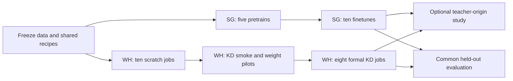

# SG and WH Training Plan: V3M, Four Teachers and Feature Distillation

- Date: 2026-11-06
- Status: Proposed execution plan; no training launched.
- SpecScopeDecision: task-specific.
- Goal: Improve V3M restoration quality through direct training, pretraining/finetuning and feature distillation, with unchanged V3M inference cost and compatibility.

## 1. Site responsibilities and assumptions

| Site | Required work | Outputs |
|---|---|---|
| SG | V3M and four teachers: pretrain, then finetune on the new trusted-GT data | Pretraining roots and new-data finetuned models |
| WH | V3M and four teachers: scratch training directly on new data | Matched V3M baselines and scratch teachers |
| WH | Four teachers distill features into V3M | Four distilled students per base-loss recipe |

Retain the initial L1-only and L1-R1_ori final-training branches. Their exact established definitions, weights and schedules must be frozen before launch. Do not infer R1_ori semantics from its name or replace it with a different regularizer.

Recommended first-round choices, distinct from user-confirmed requirements:

- **Shared pretraining:** one L1-only pretrain per architecture; branch from that same checkpoint into L1-only and L1-R1_ori finetuning. This isolates the finetune-loss comparison and avoids duplicating pretraining. Both pretraining-loss branches can be added if required.
- **Stage length:** provisionally 500K optimizer updates for each pretrain, finetune, scratch and formal KD stage. Confirm this interpretation before launch.
- **Main KD students:** start from the same fresh V3M snapshot as WH's non-KD control.
- **Main KD teachers:** use WH scratch teachers, matched to the student's base-loss recipe. Evaluate SG finetuned teachers in a clearly separated extension.

SG pretrain 500K plus finetune 500K gives 1M updates per route, versus WH scratch 500K. Compare their complete route quality and total cost; do not claim an equal-budget initialization comparison. A matched-total-budget control is optional follow-up work.

## 2. Fixed architecture matrix

| Model | Stage channels | Measured deployed convolution MAC ratio |
|---|---|---:|
| V3M | 4 / 8 / 16 / 32 | 1.0000x |
| V3L-16x | 20 / 40 / 80 / 160 | 16.5466x |
| V3L-32x | 28 / 56 / 112 / 224 | 31.6198x |
| V3L-64x | 40 / 80 / 160 / 320 | 63.3544x |
| V3L-128x | 57 / 114 / 228 / 456 | 127.0556x |

All teachers increase channels only. Three encoder/decoder levels, nine ECB/ECB2 blocks, depth 1, internal expansion 2, skip topology, Haar transforms and native six-channel residual I/O remain unchanged. Labels are approximate; actual MAC errors are below5%.

Measurement uses canvas 256x256, packed 1x6x128x128, default skip projection and an actual fused graph. It counts executed Conv2d MACs, excluding fixed Haar, interpolation, bias, activations and fusion setup. These ratios are not training FLOPs, throughput or memory estimates. See [measured profiles](../../evaluation/v3l_feature_distillation_20261106/profiles.json).

## 3. Prerequisites shared by SG and WH

1. Identify the exact **new trusted-GT version** and validate LQ/GT pairing, geometry, color domain and text/valid masks. Freeze train/validation/test manifests. Split by original scene/source before cropping so derived images cannot leak across splits.
2. Identify the **pretraining dataset** and its sampling/degradation recipe. Remove overlap with final validation/test sources. Record whether any new-data training sources are also used in pretraining.
3. Freeze the complete **L1-only and L1-R1_ori recipes**, preprocessing, patch geometry, augmentation, optimizer/LR policy, effective batch and precision.
4. Generate a seed-controlled **initial snapshot per architecture**. SG pretraining and WH scratch use the same initial snapshot for a given architecture. All WH V3M scratch/KD arms use identical V3M initial weights; record adapter seeds separately.
5. Synchronize source/config/data hashes between sites. Match contents, not absolute paths. Run a common fixed smoke batch at both sites and check shapes, target alignment and numerical consistency under the selected precision.
6. Inventory GPUs, VRAM and occupied jobs. Measure the largest teacher and teacher/student pair before reserving the formal queue. Local paths, GPU IDs and calendar dates remain unassigned until verified.

No dataset/platform names, machine paths or credentials are guessed. This document does not synchronize data, register external records or launch jobs.

## 4. SG: pretrain and new-data finetune

### SG-P: five shared pretrains

Train V3M and V3L-16x/32x/64x/128x from their fresh initializations on the approved pretraining dataset, with L1-only for 500K updates each. Preserve selected-best and final 500K weights, configs, hashes and resumable state. Select one pretraining root per architecture using the predefined validation rule.

There are **5 pretraining jobs**. No new architecture is initialized by slicing another model's weights.

### SG-F: ten finetune branches

For each of the five architectures, start two branches from its same selected SG-P checkpoint:

| Branch | Dataset | Base loss | Length |
|---|---|---|---|
| SG-F-L1 | Frozen new-data training split | L1-only | 500K |
| SG-F-R1 | Same split | L1-R1_ori | 500K |

There are **10 finetune jobs**. Load model weights, then create a fresh optimizer, scheduler and stage counter. Finetuning is a new stage, not a resume of pretraining. Use a lower LR selected by a small pilot, then freeze the stage-specific choice.

SG delivers 10 final branches, plus their selected/final checkpoints and provenance. The finetuned teachers are the optional alternative teacher pool for WH.

## 5. WH: ten direct scratch baselines

Train V3M and each of the four teachers directly on the new-data training split. Each architecture has an L1-only branch and an L1-R1_ori branch, each500K updates from the frozen fresh initialization.

There are **10 scratch jobs**:2 V3M controls and 8 teachers. The two V3M runs are mandatory matched non-KD controls. Each teacher must complete training and validation before it is used for KD.

SG pretraining and WH scratch can proceed independently after shared prerequisites are frozen. The main WH KD path does not wait for SG.

## 6. WH: recommended feature-distillation method

### 6.1 Select and freeze an already trained teacher

For each size/base-loss combination, select the WH teacher checkpoint using the same validation rule. Keep both selected-best and final 500K checkpoints; record the exact selected hash. Strict-load its matching architecture, switch to evaluation mode, disable gradients and exclude it from every student optimizer and EMA.

Use one teacher per run. Do not mix teachers in the first round. A teacher with worse held-out quality than the matching V3M baseline is not automatically eligible because it is larger; retain its result and label its KD arm deferred or exploratory.

Larger teachers do not universally produce better students; the capacity-mismatch evidence motivates testing all four candidates, not assuming128x wins. This evidence comes from classification, not a proof for our restoration setting. [Cho and Hariharan, ICCV2019](https://openaccess.thecvf.com/content_ICCV_2019/html/Cho_On_the_Efficacy_of_Knowledge_Distillation_ICCV_2019_paper.html).

### 6.2 Initialize a new V3M student

Every main KD run starts from the **same fresh V3M weights** as its WH scratch control, with fresh adapters and optimizer. Do not start from the completed WH 500K student and add another 500K while comparing against a 500K control.

The student retains direct trusted-GT supervision throughout training. Teacher guidance supplements the base objective; it does not replace GT. A later pretrained-student experiment must use the same SG-P initialization and budget for both KD and non-KD controls; that is outside the main matrix.

### 6.3 Capture eight corresponding features

Teacher and student receive the exact same augmented/degraded packed LQ tensor. GT and masks remain aligned; independent augmentation draws for teacher/student are forbidden.

| Tap | Position | Student channels | Teacher channels |
|---|---|---:|---:|
| conv0 | Stem output | 4 | w |
| enc1 | First encoder output | 8 | 2w |
| enc2 | Second encoder output | 16 | 4w |
| enc3 | Third encoder output | 32 | 8w |
| encdec | Bottleneck output | 32 | 8w |
| dec1 | First decoder after skip fusion and activation | 16 | 4w |
| dec2 | Second decoder after skip fusion and activation | 8 | 2w |
| dec3 | Final decoder after skip fusion and activation | 4 | w |

At each tap, a separate trainable 1x1 convolution projects student channels to teacher channels. Spatial sizes match exactly because topology is unchanged. Fail on missing/duplicate taps or batch/spatial mismatches; do not resize features to hide a wrong correspondence.

### 6.4 Loss and update

```text
Fs[k] = student feature at tap k
Ft[k] = frozen teacher feature at tap k
A[k]  = trainable student-to-teacher 1x1 projection
D[k]  = mean(abs(A[k](Fs[k]) - stop_gradient(Ft[k])))
Lfeat = sum(a[k] * D[k]) / sum(a[k])
Ltotal(t) = Lbase(prediction, GT, masks) + lambda(t) * Lfeat
lambda(t) = lambda_max * min(t / 5000, 1), t starts at1
```

Start with all eight stage weights a[k] = 1. Each tap is reduced by its own element mean. Preserve the exact selected L1-only or L1-R1_ori objective and its schedules. Do not add output imitation, adversarial losses or feature normalization to the first baseline.

Feature-space L1 alignment is used in published SR distillation, including [Adversarial Diffusion Compression, CVPR2025](https://openaccess.thecvf.com/content/CVPR2025/papers/Chen_Adversarial_Diffusion_Compression_for_Real-World_Image_Super-Resolution_CVPR_2025_paper.pdf). Its model family differs from ours; it supports the mechanism as a candidate, not our exact taps or hyperparameters.

Run the frozen teacher under no_grad. Update student and adapters jointly with one backward and one optimizer step. Clear captured tensors each step. Export only the student for deployment.

### 6.5 Pilot KD strength before formal training

The implemented feature_weight = 1 is an untuned default, not a validated setting.

1. Smoke-test all size/base-loss combinations on CUDA: actual teacher checkpoint, eight taps, frozen teacher hash, finite losses/gradients, changing student/adapters, valid resume and acceptable memory.
2. On the 16x teacher, compare a non-KD control with lambda_max candidates **0.01 / 0.1 / 1.0**, separately for each base loss. Proposed length: 20K; validate at 5K/10K/20K. Match initial weights, sampler order, augmentation seeds and effective batch.
3. Inspect per-stage loss scales and GT-based validation. Diagnose feature-gradient versus base-gradient norms on shared student backbone parameters after gradients become nonzero. The initial zero residual projection can produce zero base gradients; that ratio is then undefined and must not set the weight.
4. Select the stable/promising weight on development/validation data, never the final test set. Freeze it across teacher sizes within a base-loss recipe for the main size comparison. Any size-specific retuning is a separately labeled experiment.
5. If no pilot is promising, stop scaling the KD matrix. Inspect teacher errors, adapter learning and tap magnitudes. Smaller tap sets, feature normalization or different projection direction are possible later ablations, not silent changes.
6. Discard pilot student/optimizer states and restart formal runs from their original snapshots. A short pilot verifies stability and guides selection; it does not prove 500K quality.

### 6.6 Eight main KD jobs

| Student | Teacher source | Teacher sizes | Base loss | Initialization | Length per job |
|---|---|---|---|---|---|
| V3M | WH scratch, matching loss | 16x / 32x / 64x / 128x | L1-only | Shared fresh V3M | 500K |
| V3M | WH scratch, matching loss | 16x / 32x / 64x / 128x | L1-R1_ori | Shared fresh V3M | 500K |

Each KD arm is compared with the same-loss WH V3M control. The teacher checkpoint remains fixed throughout the run. Preserve selected-best and final 500K students.

### 6.7 Optional SG-teacher extension

At a promising teacher size, replace only the WH teacher with its matching SG finetuned teacher, separately for each base loss. Keep student initialization, data, feature settings and budget unchanged. This adds 2 optional jobs.

If teacher origin matters, expand to all four SG teacher sizes: 8 SG-origin KD jobs total, including the first 2. The full two-origin matrix has 16 KD jobs. Do not mix teacher origins across sizes and then interpret the ranking as a pure size effect.

## 7. Common execution protocol

These are proposed defaults; bind them to the accepted strategy after pilots:

- Pretrain/scratch/KD: Adam, initial LR 1e-4. Finetune: pilot LR 1e-5 versus 5e-5 from identical pretraining weights, then freeze one choice.
- Proposed LR schedule: 5K LR warmup, then cosine decay to 1% of initial LR at 500K. Apply the same schedule to matched scratch/KD controls. LR warmup and feature-weight warmup are distinct. If an approved legacy schedule is retained, record it instead of silently stacking schedules.
- Match effective batch using microbatching/accumulation where valid.500K means optimizer updates, not microbatches. Log both counts and samples seen. Accumulation must preserve base-loss batch reductions, particularly any batch-dependent R1 behavior; otherwise use a common feasible batch or disclose the confound.
- Match precision policy and record TF32/determinism settings. Do not silently change precision to make only one arm fit memory.
- Save resumable state every 25K; run common full validation every 50K and at 500K. Preserve selected-best and final 500K checkpoints.
- Select checkpoints using a common **GT-based validation rule**, not KD total loss: feature targets differ between teachers, so KD totals are not comparable restoration-quality scores.
- Log base/auxiliary losses, each tap loss, feature weight, LR, effective batch, iteration, samples seen, throughput and peak allocated/reserved VRAM. Estimate ETA from actual site throughput, not inference MAC ratios.

No batch size, resource allocation, date or quality-gain threshold is invented here. Existing accepted recipes take precedence once explicitly bound.

## 8. Execution order and budget



| Site/stage | Main stage jobs | Updates per job | Total updates |
|---|---:|---:|---:|
| SG pretrain | 5 | 500K | 2.5M |
| SG finetune | 10 | 500K | 5.0M |
| WH scratch | 10 | 500K | 5.0M |
| WH feature KD | 8 | 500K | 4.0M |
| **Main total** | **33** | | **16.5M** |

Counts exclude pilots, recovery and repeated seeds. They count training stages, not unique final models or GPU-hours. KD includes teacher forward plus student forward/backward and adapters; teacher preparation is additional cost.

- Both pretraining-loss branches instead of shared L1: add 5 pretraining jobs, giving 38 stages/19M updates.
- Full SG-origin KD extension with shared pretraining: add 8 KD jobs, giving 41 stages/20.5M updates.
- Both extensions: 46 stages/23M updates.

Confirm scope before reserving resources. Establish V3M controls and16x teachers early; verify 128x memory before the queue is committed. Assign dates only after actual SG/WH GPU availability and throughput measurements. Preserve unrelated running jobs.

## 9. Evaluation and hypotheses

Use immutable validation data for selection and an untouched test split for final conclusions. Where trusted GT exists, report PSNR/SSIM with explicit color/crop rules and per-scene distributions. Use recognition accuracy only with verified labels; OCR confidence alone is not correctness.

Blind visual review uses the same scenes, positions and scales. Review missing/false strokes, character topology, thin strokes, halos/ringing, noise, background and color preservation. Mark improved/tied/degraded per scene and retain failures. Freeze postprocessing and also preserve raw model outputs.

| Hypothesis | Comparison | Evidence supporting it | Contrary or inconclusive evidence |
|---|---|---|---|
| Pretraining route helps | SG finetune versus WH scratch, same model/final base loss | Better held-out quality with extra cost/data disclosed | No stable gain; different total budget prevents isolated initialization attribution |
| Teacher width improves restoration | Four WH teacher sizes versus V3M | Better validation/test quality without critical regressions | Saturation or reversal; size alone proves nothing |
| Feature KD improves V3M | KD versus matched same-loss WH V3M control | Repeatable quality gain and accepted visual review at unchanged deployment graph | Equal/worse results or gain within seed variability |
| Larger teachers distill better | Four KD sizes with shared student start/settings | Reproducibly better distilled students | Non-monotonic or worse 128x result; report it |
| Teacher origin matters | SG versus WH teacher at fixed size/loss | Student difference with other factors fixed | No stable difference or confounded comparison |

One-seed first-round results are screening evidence. Re-run the selected KD recipe and its matched control with at least 3 shared seeds before claiming robust improvement. Define the minimum useful gain and unacceptable artifact regressions before final selection; until then, findings remain exploratory rather than an automatic quality pass.

## 10. Handoff and resume

Record site, stage, model, base loss, seed, source/data/config hashes, initialization hash, teacher source/hash, optimizer/LR/precision/effective batch, selected/final checkpoints and evaluation artifacts.

Suggested run-ID templates, not discovered platform names:

```text
SG_PRE_{model}_L1_seed{seed}
SG_FT_{model}_{loss}_seed{seed}
WH_SCRATCH_{model}_{loss}_seed{seed}
WH_KD_V3M_from_{origin}_{teacher_size}_{loss}_seed{seed}
```

SG-to-WH teacher handoff includes architecture config, weights, SHA256, pretrain/finetune data versions, loss recipe, checkpoint selection record and code identity. WH verifies hashes, strict loading and a fixed forward batch before use.

Resume must restore student, adapters, optimizer, scheduler, iteration, exact teacher identity, RNG/sampler/data position and scaler state if AMP is later adopted. Resume after interruption is different from starting a finetune stage. Export only V3M weights and verify strict loading/numerical parity before inference delivery.

## 11. Readiness gates and stop conditions

Existing foundation: [implementation and usage](v3l_feature_distillation_20261106.md), [CPU acceptance](../../evaluation/v3l_feature_distillation_20261106/acceptance.json), architecture fragments under `options/v3l_feature_distillation/`.

The existing engine is a tested single-device foundation. Full BasicSR data/sampler/resume integration, accumulation, AMP/DDP/EMA if required, CUDA numerical behavior and GPU memory still need implementation/validation. It accepts a scalar base-loss callable and does not implement or redefine R1_ori.

Before formal runs, require frozen/leakage-checked data and losses, site parity, 128x teacher/KD capacity checks, eight correct taps, unchanged teacher parameters, finite nonzero student/adapter gradients, matching zero-KD updates, correct R1 reductions, functional resume and reviewed pilot/selection settings.

Stop an affected run on non-finite losses/gradients, teacher drift, wrong data/weights/taps, resume mismatch or resource failure. Preserve evidence, correct the cause and record restart/resume identity. Finishing 500K is not automatically a quality success.

## 12. Decisions required before execution

1. Exact new trusted-GT and pretraining versions/manifests, and established L1-R1_ori recipe.
2. Confirm 500K per stage and shared L1-only pretraining versus both pretraining losses.
3. Verified SG/WH hardware, effective batch/precision and storage roots.
4. Main WH-teacher pool plus staged SG extension, or the full two-origin KD matrix from the start.
5. Final validation selection rule, minimum useful gain and unacceptable regressions.

No training-quality result or completion date is claimed. This is a reviewable two-site plan; actual synchronization, resource reservations, external writes and training launch require execution binding.
