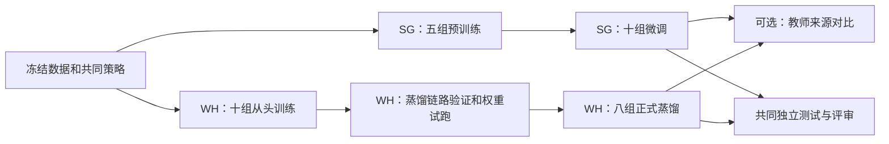

# SG 与 WH 两地训练计划：V3M、四档教师模型与特征蒸馏

- 日期：2026-11-06。
- 状态：待评审的执行计划，尚未启动训练。
- 约束范围：仅适用于本轮任务（SpecScopeDecision: task-specific）。
- 目标：通过直接训练、预训练后微调及特征蒸馏，提高 V3M 的文字恢复效果，同时保持其推理计算量和接口兼容性。
- 文档语言：按用户明确要求提供中文版；与英文计划保持相同实验范围和预算。

## 1. 两地分工与计划假设

| 地点 | 训练内容 | 交付结果 |
|---|---|---|
| SG | V3M 和四档教师模型：先预训练，再使用新版可信 GT 数据微调 | 预训练权重、新版数据微调权重 |
| WH | V3M 和四档教师模型：直接使用新版数据从头训练 | V3M 对照模型、四档教师模型 |
| WH | 四档教师分别向 V3M 进行特征蒸馏 | 每种基础损失对应四个蒸馏后的 V3M |

保留最初提出的 **L1-only / L1-R1_ori** 两种最终训练分支。开训前必须明确两者的既有定义、权重和调度，不根据名称猜测 R1_ori 的含义，也不替换成其他正则项。

以下是本计划的推荐方案，尚需在执行前确认：

- **共享预训练底座**：每种结构先完成一次 L1-only 预训练，再从同一权重分出 L1-only 和 L1-R1_ori 两条微调分支。这样便于比较微调损失，并避免重复预训练。如果需要比较预训练损失，再增加另一组预训练。
- **阶段长度**：暂按预训练、微调、从头训练和正式蒸馏各 500K 次优化器更新安排。
- **蒸馏学生初始化**：主实验从与 WH 非蒸馏对照组完全相同的 V3M 随机初始权重开始。
- **蒸馏教师来源**：主实验优先使用 WH 从头训练的教师，并匹配基础损失；SG 微调教师作为独立扩展实验。

SG 的预训练 500K＋微调 500K，合计为 1M 次更新；WH 从头训练为 500K。因此两者比较的是整条训练路线的效果与成本，不能将结果解释为等预算下单独改变初始化的收益。等总训练预算的对照可作为后续补充。

## 2. 固定模型结构

| 模型 | 四级通道数 | 实测部署卷积计算量，相对 V3M |
|---|---|---:|
| V3M | 4 / 8 / 16 / 32 | 1.0000× |
| V3L-16x | 20 / 40 / 80 / 160 | 16.5466× |
| V3L-32x | 28 / 56 / 112 / 224 | 31.6198× |
| V3L-64x | 40 / 80 / 160 / 320 | 63.3544× |
| V3L-128x | 57 / 114 / 228 / 456 | 127.0556× |

四档教师仅扩大通道。保持三级编码/解码、九个 ECB/ECB2 block、深度系数 1、内部扩张系数 2、跳连、Haar 变换及六通道残差输入输出不变。型号表示近似计算量档位，实测误差均小于 5%。

计算量测量条件为 256×256 画布、打包后的 1×6×128×128 输入、默认跳连投影和实际融合部署图。统计执行的 Conv2d 乘加次数（MACs），不包括固定 Haar、插值、偏置、激活和卷积核融合准备开销。该比例不代表训练计算量、速度或显存比例。详见[实测结果](../../evaluation/v3l_feature_distillation_20261106/profiles.json)。

## 3. SG 与 WH 的共同前置条件

1. **同步新版可信 GT**：明确版本，检查 LQ/GT 配对、尺寸与对齐、颜色定义及文字/有效区域掩码。冻结训练、验证、测试清单。先按原始场景或来源划分，再裁块，避免同源图片泄漏到不同集合。
2. **明确预训练数据**：冻结数据版本、采样和退化策略，排除与最终验证/测试集的来源重叠。若预训练包含新版训练集来源，必须记录。
3. **冻结训练策略**：明确 L1-only、L1-R1_ori 的完整配置，以及预处理、裁块、增强、优化器、学习率、有效批量和精度。
4. **统一初始权重**：每种结构生成一份固定随机种子的初始权重。同一结构的 SG 预训练和 WH 从头训练从相同权重开始。WH 的 V3M 非蒸馏与所有主蒸馏实验共享同一初始权重；适配器随机种子单独记录。
5. **核对两地一致性**：同步代码、配置和数据校验值，核对内容而非路径。使用同一固定批次检查输入形状、目标对齐，以及选定精度下的数值一致性。
6. **核实算力**：确认 GPU、显存和已有任务占用。正式排队前，测试最大教师的训练及最大教师＋学生的蒸馏显存。实际目录、GPU 编号及完成日期在核实后确定。

本计划不猜测数据平台名称、机器路径和凭据，也不执行数据同步、外部登记或训练启动。

## 4. SG：预训练与新版数据微调

### 4.1 SG-P：五组共享预训练

V3M、V3L-16x、32x、64x、128x 分别从各自的随机初始权重开始，在批准的预训练数据上使用 L1-only 训练 500K。

保留验证集选中的最佳权重、最终 500K 权重、配置、校验值和续训状态。按照预先定义的验证规则，为每种结构选定一份预训练底座。

共 **5 组预训练**。不同结构之间不通过裁剪其他模型权重进行初始化。

### 4.2 SG-F：十组微调

每种模型从同一份已选预训练权重分出两个分支：

| 分支 | 数据 | 基础损失 | 长度 |
|---|---|---|---|
| SG-F-L1 | 冻结的新版数据训练集 | L1-only | 500K |
| SG-F-R1 | 同一训练集 | L1-R1_ori | 500K |

五种模型共 **10 组微调**。只加载模型权重，重新创建优化器、学习率调度器和阶段计数。微调是新训练阶段，不是恢复预训练进程。通过短程试跑选择较低的微调学习率，再固定执行。

SG 交付十组最终分支及对应最佳/最终权重和来源记录。其中的教师模型可供 WH 后续开展教师来源对比。

## 5. WH：十组新版数据从头训练

V3M 和四档教师均直接使用新版训练集，从各自冻结的随机初始权重开始。每种结构分别使用 L1-only、L1-R1_ori 训练，各 500K。

共 **10 组训练**：2 组 V3M 对照，8 组教师。两组 V3M 是蒸馏收益的必要对照。教师必须完成训练与验证后，才能用于蒸馏。

共同前置条件冻结后，SG 预训练与 WH 从头训练可以并行。WH 主蒸馏路线不依赖 SG 完成。

## 6. WH：特征蒸馏具体方法

### 6.1 先训练教师，再冻结教师

对每个“教师尺寸＋基础损失”组合，按统一验证规则选择 WH 教师权重。保留最佳和最终 500K 权重，记录实际选中权重的校验值。

严格加载对应结构和权重，切换为评估模式，关闭梯度，并将教师排除在学生优化器和权重滑动平均（EMA）更新之外。

每次蒸馏只使用一位教师，第一轮不混合多位教师。若教师在独立验证数据上不如对应 V3M，不应仅因模型更大就默认投入主蒸馏；保留结果，将该分支标记为暂缓或探索。

更大的教师不保证教出更好的学生，因此需要比较四个档位，不能预设 128x 最优。相关容量不匹配研究来自分类任务，不能直接证明本项目的恢复效果。[Cho 与 Hariharan，ICCV 2019](https://openaccess.thecvf.com/content_ICCV_2019/html/Cho_On_the_Efficacy_of_Knowledge_Distillation_ICCV_2019_paper.html)。

### 6.2 学生从统一随机初始权重开始

主蒸馏实验全部使用原始 V3M 结构，从与 WH 非蒸馏对照组**完全相同的随机初始权重**开始，适配器和优化器也重新初始化。

不要将已经训练 500K 的 V3M 再蒸馏 500K，却与只训练 500K 的对照比较，否则额外训练预算也可能带来收益。

整个蒸馏过程保留可信 GT 的直接监督。教师指导作为额外约束。后续若比较预训练学生，应让蒸馏组和非蒸馏微调组同时从同一份 SG-P 权重开始，并保持预算一致；该实验不计入主矩阵。

### 6.3 提取八处对应特征

教师和学生接收**完全相同的增强、退化和打包后的 LQ 张量**。GT 和掩码保持对齐，不能分别随机增强教师与学生输入。

| 特征位置 | 含义 | 学生通道 | 教师通道 |
|---|---|---:|---:|
| conv0 | 初始特征层输出 | 4 | w |
| enc1 | 第一级编码输出 | 8 | 2w |
| enc2 | 第二级编码输出 | 16 | 4w |
| enc3 | 第三级编码输出 | 32 | 8w |
| encdec | 瓶颈输出 | 32 | 8w |
| dec1 | 第一级解码，跳连融合及激活后 | 16 | 4w |
| dec2 | 第二级解码，跳连融合及激活后 | 8 | 2w |
| dec3 | 最后一级解码，跳连融合及激活后 | 4 | w |

每处单独使用可训练的 1×1 卷积，将学生通道投影至教师通道。结构一致使对应特征的空间尺寸一致。遇到缺失、重复特征或批量/空间尺寸不匹配时直接报错，不用缩放掩盖对应错误。

### 6.4 损失与更新方式

```text
Fs[k]：学生第 k 处特征
Ft[k]：冻结教师第 k 处特征
A[k] ：学生通道到教师通道的可训练 1×1 投影
D[k] = mean(abs(A[k](Fs[k]) - stop_gradient(Ft[k])))
Lfeat = sum(a[k] * D[k]) / sum(a[k])
Ltotal(t) = Lbase(预测, GT, 掩码) + lambda(t) * Lfeat
lambda(t) = lambda_max * min(t / 5000, 1)，t 从 1 开始
```

八处权重初始均设为 a[k] = 1。每处先对自身全部元素取平均，避免通道数直接放大其损失贡献。

保留选定的 L1-only 或 L1-R1_ori 基础目标及既有调度。第一轮不增加输出模仿、对抗损失或特征归一化。

超分蒸馏研究中已有特征空间 L1 对齐的使用案例，例如 [Adversarial Diffusion Compression，CVPR 2025](https://openaccess.thecvf.com/content/CVPR2025/papers/Chen_Adversarial_Diffusion_Compression_for_Real-World_Image_Super-Resolution_CVPR_2025_paper.pdf)。其模型类型与本项目不同，只能支持将该机制作为候选，不能证明本计划的八处位置和参数最优。

教师前向关闭梯度计算；学生与适配器通过一次反向传播和一次优化器更新联合学习。每步释放捕获的特征。部署仅导出学生。

### 6.5 先短程试跑，再确定蒸馏强度

现有实现的 feature_weight = 1 只是未调优默认值。

1. **CUDA 链路验证**：覆盖所有教师尺寸和基础损失组合。验证实际教师权重、八处特征、教师权重不变、损失与梯度有限、学生和适配器更新、续训正确且显存可承受。
2. **16x 教师权重试验**：每种基础损失分别比较非蒸馏对照，以及 lambda_max 为 **0.01 / 0.1 / 1.0** 的蒸馏。建议各跑 20K，在 5K、10K、20K 验证。统一学生初始权重、采样顺序、增强种子和有效批量。
3. **检查损失与梯度量级**：记录各层特征损失及 GT 验证结果。在梯度非零后，检查共享学生骨干上特征损失梯度与基础损失梯度的范数比。初始零残差投影可能导致基础梯度为零，此时比值无定义，不能据此设置权重。
4. **固定主比较参数**：只在开发/验证数据上选择稳定且有潜力的权重，不使用最终测试集调参。同一种基础损失下，四档教师共用选定权重。若单独为某一档重调，必须标为独立实验。
5. **无收益时先排查**：若所有候选都没有潜力，暂停扩大蒸馏矩阵，检查教师错误、适配器学习和特征量级。减少特征位置、归一化或改变投影方向可作为后续实验，不静默加入第一轮。
6. **正式训练重新开始**：丢弃试跑学生和优化器状态，正式实验重新从冻结的初始权重开始。短程试跑用于检查稳定性和筛选参数，不能证明最终 500K 收益。

### 6.6 八组主蒸馏实验

| 学生 | 教师来源 | 教师尺寸 | 基础损失 | 学生初始化 | 每组长度 |
|---|---|---|---|---|---|
| V3M | WH 从头训练，损失匹配 | 16x / 32x / 64x / 128x | L1-only | 统一随机初始权重 | 500K |
| V3M | WH 从头训练，损失匹配 | 16x / 32x / 64x / 128x | L1-R1_ori | 统一随机初始权重 | 500K |

每组与相同基础损失的 WH 非蒸馏 V3M 比较。训练全过程固定教师权重，保留最佳和最终 500K 学生权重。

### 6.7 可选：使用 SG 微调教师

先在一个有潜力的教师尺寸上，分别针对两种基础损失，将 WH 教师替换成对应的 SG 微调教师。学生初始化、数据、蒸馏参数和预算全部保持一致，新增 2 组。

若教师来源确有影响，再扩展至全部四档 SG 教师：SG 来源共 8 组，**包含前述 2 组**。完整双来源矩阵共 16 组蒸馏。不能混用不同档位的教师来源后，将排名解释为单纯的尺寸效应。

## 7. 共同训练设置

以下为建议默认值，需结合既有批准策略和试跑结果冻结：

- 预训练、从头训练、蒸馏使用 Adam，初始学习率建议 1e-4。微调从同一预训练权重比较 1e-5 / 5e-5，再固定选择。
- 学习率调度建议先预热 5K，再余弦衰减至 500K 时初始学习率的 1%。匹配的非蒸馏/蒸馏学生使用相同调度。学习率预热与特征损失权重预热是两个独立机制。保留既有调度时明确记录，不叠加多套调度。
- 在数学等价的条件下，用小批次和梯度累积统一有效批量。500K 指优化器更新次数，需同时记录小批次数和样本数。尤其核对 R1 是否依赖整批统计；若累积不能保持其定义，应统一为可运行的批量，或披露比较中的混杂因素。
- 统一数值精度，记录 TF32 和确定性设置。不能为了某一分支适配显存而静默改变精度。
- 每 25K 保存可续训状态，每 50K 及最终 500K 做共同完整验证，保留最佳与最终权重。
- 用统一的 **GT 验证规则**选权重，不用蒸馏总损失排名：不同教师的特征目标不同，总损失不能直接代表恢复效果。
- 记录基础/辅助损失、逐层特征损失、蒸馏权重、学习率、有效批量、步数、样本数、吞吐和显存分配/预留峰值。根据各地实际吞吐估算完成时间，不根据部署 MAC 比例推算。

未核实的批量、资源、日期和效果阈值不作为既定事实。明确绑定后，以已批准的训练策略为准。

## 8. 执行顺序与训练量



| 地点/阶段 | 主计划阶段数 | 每阶段更新次数 | 总更新次数 |
|---|---:|---:|---:|
| SG 预训练 | 5 | 500K | 2.5M |
| SG 微调 | 10 | 500K | 5.0M |
| WH 从头训练 | 10 | 500K | 5.0M |
| WH 特征蒸馏 | 8 | 500K | 4.0M |
| **主计划合计** | **33** | | **16.5M** |

上表不含试跑、失败恢复和多种子复验。统计的是训练阶段，不是不同最终模型的数量，也不是 GPU 小时。蒸馏阶段还包含教师前向、学生前向/反向和适配器开销；教师自身训练是额外成本。

- 若预训练也分别比较两种损失，增加 5 组预训练：合计 **38 阶段、19M 更新**。
- 若完整增加 SG 来源蒸馏，且保留共享预训练：增加 8 组，合计 **41 阶段、20.5M 更新**。
- 两项扩展都做：合计 **46 阶段、23M 更新**。

预留资源前确认范围。优先建立 V3M 对照和 16x 教师，提前检查 128x 显存。核实 SG/WH GPU 可用情况及吞吐后再排日期，保留其他正在运行的任务。

## 9. 效果评估与待验证假设

验证集用于选权重和参数，独立测试集用于最终结论。可信 GT 场景统计 PSNR/SSIM，明确颜色域和裁边规则，并保留逐场景分布。有经核验文字标注时再统计识别准确率；OCR 置信度不能替代内容正确性。

主观评审隐藏模型标签，统一场景、位置和缩放，检查缺笔/多笔、字符拓扑、细笔画、光晕/振铃、噪声、背景和颜色保持。逐场景记录改善/持平/变差，保留失败案例。固定后处理，并保存原始模型输出。

| 假设 | 对照方式 | 支持证据 | 反对或无法下结论的情况 |
|---|---|---|---|
| 预训练路线有收益 | 同模型、同最终损失的 SG 微调与 WH 从头训练 | 披露额外预算和数据后的独立测试改善 | 收益不稳定；总预算不同，无法单独归因于初始化 |
| 教师加宽改善恢复 | WH 四档教师与 V3M 比较 | 效果改善且无关键退化 | 收益饱和或反转；尺寸本身不构成证据 |
| 特征蒸馏改善 V3M | 蒸馏学生与匹配的 WH V3M 对照 | 推理结构不变，效果可重复改善且主观评审接受 | 持平/变差，或收益落在种子波动内 |
| 教师越大越利于蒸馏 | 同学生初始化、同参数的四档蒸馏 | 蒸馏学生效果可重复随尺寸改善 | 不单调或 128x 更差，应如实记录 |
| 教师来源影响收益 | 固定尺寸和损失，仅替换 SG/WH 教师 | 其他因素一致时学生出现稳定差异 | 无稳定差异或比较条件混杂 |

首轮单种子结果仅用于筛选。选定方案与对应非蒸馏对照至少用 3 个配对种子复验，再判断是否有稳定收益。最终选择前明确最小有用改善量和不可接受的伪影退化；此前属于探索性结果，不自动判定效果通过。

## 10. 两地交付与断点续训

每组记录地点、阶段、模型、基础损失、种子、代码/数据/配置校验值、初始化权重、教师来源与校验值、优化器/学习率/精度/有效批量、最佳/最终权重和评估产物。

建议任务命名模板如下，实际平台和存储名称另行核实：

```text
SG_PRE_{model}_L1_seed{seed}
SG_FT_{model}_{loss}_seed{seed}
WH_SCRATCH_{model}_{loss}_seed{seed}
WH_KD_V3M_from_{origin}_{teacher_size}_{loss}_seed{seed}
```

SG 向 WH 交付教师时，包含结构配置、权重、SHA256、预训练/微调数据版本、损失配置、权重选择记录和代码身份。WH 使用前核对校验值、严格加载，并运行固定输入验证。

续训恢复学生、适配器、优化器、调度器、步数、固定教师身份、随机状态、采样与数据位置；后续采用混合精度时还需恢复梯度缩放状态。中断续训与启动微调阶段是不同操作。推理交付只导出 V3M，并检查严格加载及数值一致性。

## 11. 开训条件与停止条件

现有基础：[结构与使用说明](v3l_feature_distillation_20261106.md)、[CPU 验收记录](../../evaluation/v3l_feature_distillation_20261106/acceptance.json)，以及 `options/v3l_feature_distillation/` 下的结构配置片段。

现有引擎已完成单设备 CPU 正确性验证。正式启动前仍需完成真实 BasicSR 数据/采样/续训流程接入，验证梯度累积，以及需要使用的混合精度、多卡和 EMA；还需验证 CUDA 数值与显存。引擎接收返回标量的基础损失函数，不实现或改写 R1_ori。

正式训练前应确认：数据和损失已冻结并排除泄漏；两地配置一致；128x 教师训练与蒸馏可承载；八处特征对应正确；教师参数不变；学生与适配器梯度有限且非零；关闭蒸馏时更新与对照一致；R1 归约正确；续训可用；试跑和权重选择规则已评审。

出现非有限损失/梯度、教师漂移、数据/权重/特征错配、续训不一致或资源失败时，停止受影响任务，保留日志和权重，修正原因并记录重新启动或恢复身份。完成 500K 不等于效果成功。

## 12. 正式执行前待确认项

1. 新版可信 GT、预训练数据的确切版本与清单，以及既有 L1-R1_ori 配置。
2. 是否每阶段均为 500K；是否采用共享 L1-only 预训练，还是预训练也分两种损失。
3. SG/WH 实际硬件、有效批量、精度和存储目录。
4. 是否先用 WH 教师做主实验、再扩展 SG 教师，还是从一开始就预留完整双来源蒸馏矩阵。
5. 最终验证选择规则、最小有效收益和不可接受退化。

本计划不声称训练效果已验证，也不承诺未测算的完成日期。实际同步、资源预留、外部写入和训练启动需在执行阶段绑定具体条件。
