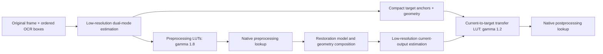

# Frozen Adaptive Preprocessing and Postprocessing v1

## 1. Version and delivery scope

| Field | Frozen value |
|---|---|
| Package | `adaptive_prepost_frozen_v1_20261020` |
| Freeze date | 2026-10-20 |
| Preprocessing context version | `adaptive_dualmode_scurve_v1` |
| Preprocessing rails | Dark-group mode / bright-group mode; no P10 |
| Preprocessing gamma | **1.8** |
| Default postprocessing gamma | **1.2**, preserving the existing code default |
| Postprocessing comparison profiles | 1.0: brightness transfer; 1.8: stronger clarity |
| Correction gating | None; every selected column uses the curve |
| Statistics resolution | 1984 x 1472 |
| Native rendering | Integer LUT lookup/interpolation and bounded common BGR offset |

This package freezes the current implementation at the user's request. It is a reproducible baseline, including the known 093 shadow limitation. Freezing does not mean that all-image quality, a particular postprocessing strength, or production integration has been accepted. No algorithm or model parameter is tuned in this packaging step.

The package contains both implementations and their shared estimator/renderer. It does not depend on the previous dated evaluation directory or the historical V5 postprocessor. NumPy and OpenCV are required; PyTorch and model weights are not required for these CPU stages. `environment.json` records the Python/OpenCV/NumPy versions used for this freeze. Cross-library or camera-YUV equivalence must be validated separately.

## 2. Goal and boundaries

Preprocessing suppresses bright/dark edge excursions and tightens text transitions while retaining local illumination. It estimates both brightness rails symmetrically, allowing either dark text or bright text without selecting a semantic polarity branch.

Postprocessing has only two tonal effects: clarity of the model/upscaled text transitions, and restoration of reference brightness. They are fused into one current-to-reference S-curve LUT. There is no separate USM pass, glyph repair, border protection, or dataset-specific cleanup.

The S-curve changes tonal transitions; it does not create new spatial detail, perform resizing, replace the restoration model, or remove the page's shadow. Model inference and any required Bicubic/warp operations remain outside this package.

## 3. Pipeline and call flow



Function-level route:

1. `preprocess.prepare_context` -> `estimate_line(..., lower_estimator='mode')` -> `strip_histograms`; then `build_tables(..., gamma=1.8)`.
2. `preprocess.apply_preprocess` -> `prepare_mapping` -> `apply_tables`.
3. `preprocess.make_post_context` retains geometry and target anchors; no additional image statistics.
4. External model inference produces the aligned output frame.
5. `postprocess.postprocess_bgr` -> `estimate_line(..., lower_estimator='mode')` -> `build_transfer_tables` -> `prepare_mapping` -> `apply_tables`.

All lines sample immutable stage input pixels. Overlap is resolved in the supplied order with first ownership. The next line cannot repeatedly correct an already owned pixel. Outside the selected box union, the stage input remains unchanged.

## 4. Input, luminance and geometry contracts

- Image interface: `H x W x 3` uint8 BGR, nominal values 0..255.
- Reference luminance: OpenCV `COLOR_BGR2YCrCb`, selecting Y. This JPEG prototype is not an implementation of camera limited-range Y or production Y4UV packing.
- Original OCR boxes: integer half-open `[x0, y0, x1, y1]`, inside the original decoded image. Keep their order and frame identity.
- Canvas: fixed width 1984, height 1472, linear interpolation. Axis scales are independent.
- Native-to-canvas horizontal coordinate: `x = (X + 0.5) * canvas_width / native_width - 0.5`.
- Canvas boxes use floor on left/top and ceil on right/bottom. LUT centers are spaced by four canvas columns, beginning at local 1.5 and capped at the last column.

Preprocessing accepts its original frame at the original shape. Postprocessing permits an aligned full-frame output with independent x/y scaling; it scales box coordinates accordingly. It does not automatically detect incorrect frame identity, a crop, rotation, or perspective warp. The caller must preserve and validate that relationship.

For rectified/rotated model lines, either carry the actual transforms with per-line context, or reverse the transformations and compose an aligned full frame before calling this API. The four-image real-model test used the second route. Inference tile blending and geometric pasteback feathering are external composition operations; removing postprocessing guards does not remove them.

## 5. Preprocessing estimator

### 5.1 Low-resolution illumination scale

For each canvas line:

1. Accumulate 256-bin histograms in non-overlapping four-column strips.
2. Use prefix differences for windows of up to 16 canvas columns. No repeated native-image windows are scanned.
3. Compute Q70, Q85 and Q90. Q85 is the local illumination candidate.
4. Compute an edge Q85 from the first two and last two row samples. A candidate seed satisfies `Q90-Q70 <= 12`, `abs(edge_Q85-Q85) <= 16`, and `Q85 >= 32`.
5. Interpolate candidates across **all** node positions, with endpoint extension and no maximum-gap cutoff. If no seed exists, use the local Q85 candidates directly.
6. Apply `B = max(B, 32)` to bound normalization arithmetic.

The historical code names this field `paper`. It is an illumination-scale guide, not a guaranteed semantic paper/background label on every polarity. Seed selection affects the estimate only; it cannot disable correction.

### 5.2 Shared statistical coordinate and rails

On the low-resolution row only:

`z = round(128 * Y / B(x))`.

All columns participate in a 1024-bin histogram. With `B>=32`, uint8 Y yields `z<=1020`. One Otsu split yields integer threshold `t`; the midpoint is `Tn=t+0.5`.

- `Ln`: mode of bins 0..t.
- `Hn`: mode of bins t+1..1023.
- No lower-tail percentile is used.

Minimum group count `max(16,0.005*N)` and `abs(Hn-128)<=12` are retained as historical confidence telemetry. These checks never reject a line in this no-gate version. An invalid mathematical ordering uses the recorded normalized fallback `(0,64,128)`; this is still a gamma-1.8 curve rather than an identity bypass.

Recover local original-domain anchors:

`(L,T,H)(x) = B(x)/128 * (Ln,Tn,Hn)`.

If H exceeds 255, multiply all three anchors by the same `min(1,255/H)` factor. This keeps their ordering and fits the LUT range, but is a model adjustment that can affect tones; it is not claimed lossless.

### 5.3 Frozen preprocessing S-curve

For `L<T<H`, `g=1.8`:

```text
v <= T: F(v) = L + (T-L) * clip((v-L)/(T-L), 0, 1)^g
v >  T: F(v) = H - (H-T) * clip((H-v)/(H-T), 0, 1)^g
```

Thus values below L map to L, values above H map to H, and `F(L)=L`, `F(T)=T`, `F(H)=H`. No extra strength mask or identity table is mixed in.

The dark/bright roles naturally exchange between dark-on-light and light-on-dark content. This removes the P10-specific dark-background bias; it does not prove perfect rail estimation for mixed colors, thin strokes or all lighting distributions.

## 6. Postprocessing: current-to-reference transfer

Let the current model-output anchors be `Lc<Tc<Hc` and the preprocessing reference anchors be `Lr<Tr<Hr`. Current anchors are estimated again on the fixed low-resolution output canvas. Reference anchors are reused directly from preprocessing.

For the frozen default `g=1.2`:

```text
v <= Tc: F(v) = Lr + (Tr-Lr) * clip((v-Lc)/(Tc-Lc), 0, 1)^g
v >  Tc: F(v) = Hr - (Hr-Tr) * clip((Hc-v)/(Hc-Tc), 0, 1)^g
```

This maps `Lc,Tc,Hc` to `Lr,Tr,Hr`. The current-to-target endpoint mapping performs brightness/range repair, while gamma steepens interior tonal transitions. Both effects use one LUT and one native rendering pass.

Example: current anchors `(20,110,200)`, reference `(10,100,190)`:

- Gamma 1 maps the three anchors to `(10,100,190)` and intensity 65 to 55.
- Gamma 1.2 preserves the same endpoint mappings and maps 65 to approximately 49.17.

Gamma 1 is the brightness-only comparison. It is piecewise linear inside the rails and still clips outside them. It is not a universal identity operation. With identical current/reference anchors it is identity inside `[L,H]`; full 256-level identity requires rails 0 and 255.

Gamma 1.8 is a stronger comparison retained in the evidence, not the frozen default. The API accepts a gamma override; overriding 1.2 changes the frozen postprocessing profile and must be recorded.

## 7. Reuse and state lifetime

| Item | Reuse decision |
|---|---|
| Frame/line IDs, order, coordinates and geometry | Required across both stages |
| Preprocessing illumination estimate | Reused through recovered local target anchors |
| Target L/T/H and canvas centers | Retained directly for postprocessing |
| S-curve family and fixed-point native renderer | Shared implementation |
| Preprocessing LUT itself | Not blindly applied again to model output |
| Current model-output rails | Re-estimated at low resolution |
| Postprocessing LUT | Built once per current line; may be reused for matching patches |

Directly applying the preprocessing LUT again can compound contrast through `S(S(v))`. Clipped tails are not uniquely invertible. A model can also shift the current rail positions, so reusing the target does not justify assuming current and target anchors are identical.

`make_post_context` retains only the version, reference ID, source/canvas dimensions, geometry declaration, line order/boxes, target normalized anchors, local target anchors and canvas centers. It omits full histograms, profiles and preprocessing LUTs. Release the larger preparation context when no longer needed.

The compact per-node numerical payload is four float32 values, 16 bytes, excluding line metadata and Python/JSON overhead. One preprocessing LUT requires 256*2=512 bytes/node. Example reference payloads: 002: 77,008 bytes; 006: 45,792; 089: 131,184; 093: 228,864. The Python preparation API currently caches all line LUTs for replay; row-streaming is a deployment recommendation, not already implemented.

## 8. Native rendering and color

Each node stores a 256-entry uint16 Q8.8 LUT. Per-native-column geometry precomputes neighboring nodes and an integer Q12 weight `w` in 0..4096.

```text
mapped_Y = (LUT_left[Y]*(4096-w) + LUT_right[Y]*w + 2^19) >> 20
delta = mapped_Y - original_Y
delta = clamp(delta, -min(B,G,R), 255-max(B,G,R))
output_BGR = input_BGR + delta
```

The shared offset preserves channel differences within available RGB headroom. Saturated colors can limit the applied change, so actual Y may not reach the requested LUT value. The package does not silently replace this with independent channel clipping or a new chroma correction.

Histograms, Otsu, normalization, rail estimation and power evaluation use low-resolution inputs/tables. Native work includes Y conversion, geometry lookup, table interpolation, the bounded offset, and placement. No claim is made that all native work disappears. The current Python APIs may repeat full-frame Y conversion between preparation and rendering; a production integration should reuse existing Y buffers explicitly.

## 9. What was removed from historical V5

The new postprocessor does not import or execute the historical V5 processing chain. It removes border-backed polarity fallbacks, thin/core/flat masks, morphology and distance protection, robust masked background fitting, bilateral/core repair, connected-component interior repair, exterior-tail repair, crop border exclusion/fade, HSV board-frame protection, PPT residual median/rule fixes, optional high-pass residual filtering, and V6 chroma return.

The legacy script remains available in the workspace as a comparison baseline. Its presence is not a runtime dependency of this package. The legacy baseline and the new path have different processing domains/protections by design; their comparison evaluates complete postprocessing variants rather than isolating only gamma.

## 10. Cost and measured evidence

For A low-resolution row pixels, K LUT nodes and N native rendered pixels:

- Strip/statistical preparation: approximately `O(A + 256*K)`.
- LUT construction: `O(256*K)`; all power operations are here.
- Native application/placement: `O(N)`.
- Larger model-output geometry increases native application cost even though the statistics canvas stays fixed.

The four-image test used the same strict-loaded V5 H96 final-250K checkpoint, 101 cached quads and 840 model patches. Checkpoint SHA256:

`de3af40f67646e5335cfdfe6b794ea75ce6f666e1396fac305550a12a3fc9403`.

Single-run Python CPU postprocessing measurements, one OpenCV thread:

| Image | Historical V5 ms | Gamma 1 ms | Default gamma 1.2 ms | Gamma 1.8 ms |
|---|---:|---:|---:|---:|
| 002 | 6649.4 | 665.3 | 733.3 | 882.8 |
| 006 | 5747.4 | 455.0 | 405.6 | 496.3 |
| 089 | 7967.6 | 826.6 | 768.5 | 933.4 |
| 093 | 10136.2 | 1050.3 | 1082.8 | 1324.7 |

These are whole-image reference-code measurements, excluding diagnostic metrics/export. Arms ran sequentially rather than as an interleaved repeated benchmark. Do not interpret the table as stable speedup, mobile latency, or measured C++ cost. No new model inference is performed during this freeze.

## 11. Quality evidence and known limitations

006 supports the target-reference brightness mapping. Using the same original-defined dark support, the English title background median is original 88, fresh model output 86, historical V5 86, and default adaptive output 88. The Chinese title is original 84, model 81, historical V5 78, and default adaptive output 84.

002 retains visible model-generated edge texture at gamma 1.2. A stronger curve reduces more texture but requires checking thin strokes. There is no automatic all-image winner.

093 has a known shadow problem. The fixed native ROI `[320,3750,640,3860]` uses one Otsu split from the raw original and reuses exactly the same ink/paper pixel supports:

| Stage | Ink median | Paper median | Contrast |
|---|---:|---:|---:|
| Raw original | 22 | 88 | 66 |
| Frozen preprocessing | 25 | 89 | 64 |
| Model-route composite | 75 | 93 | 18 |
| Historical V5 | 74 | 93 | 19 |
| Gamma 1 | 69 | 87 | 18 |
| Default gamma 1.2 | 71 | 88 | 17 |
| Gamma 1.8 | 74 | 89 | 15 |

The first measured loss is inside the rectification/model/inverse-pasteback route. These data do not isolate the neural network from geometric resampling/composition. Stronger postprocessing is not a demonstrated fix. This known limitation is included in the frozen baseline, not hidden behind a gate or marked resolved.

Other limitations: downsampling can bias dark/bright modes; mixed ink reflectance or nonmultiplicative illumination can violate the normalization model; one horizontal illumination value per column does not model strong variation across the line height; unfeathered rectangular postprocessing can reveal box boundaries; saturated colors limit brightness correction; wrong geometry/context silently invalidates the reference relationship.

## 12. API and reproducibility

From the repository root:

```python
import json
from evaluation.adaptive_prepost_frozen_v1_20261020.preprocess import (
    prepare_context, apply_preprocess, make_post_context,
)
from evaluation.adaptive_prepost_frozen_v1_20261020.postprocess import postprocess_bgr

context = prepare_context(original_bgr, boxes, reference_id=frame_id)
model_input = apply_preprocess(original_bgr, context)
post_context = make_post_context(context)
# Save post_context as JSON, release context, and run the external model.
result, report = postprocess_bgr(aligned_model_output, post_context)  # gamma=1.2
```

CLI for an already aligned model output:

```text
python -m evaluation.adaptive_prepost_frozen_v1_20261020.postprocess --prediction MODEL.png --context FRAME.context.json --output RESULT.png
python evaluation/adaptive_prepost_frozen_v1_20261020/verify.py
```

After extracting the ZIP elsewhere, run `python adaptive_prepost_frozen_v1_20261020/verify.py` from its parent directory. CLI execution is then `python -m adaptive_prepost_frozen_v1_20261020.postprocess ...`. The package uses relative imports and has no dependency on the old dated directory. Do not move individual implementation files out of the package.

`manifest.json` hashes code, fixed config, documentation and bundled evidence. `provenance.json` records source hashes and import-only packaging edits. `SHA256SUMS.txt` additionally provides the manifest hash. A manifest is an integrity/reproducibility record, not a cryptographic signature from an external authority. Do not edit this frozen directory in place; create a new version for algorithm or parameter changes.

## 13. Delivery and acceptance status

- `preprocess.py`: fixed preprocessing API and compact downstream context.
- `postprocess.py`: default reference-transfer postprocessing and CLI.
- `lowres_curve.py`: exact shared estimator and native renderer snapshot.
- `config.json`, `environment.json`, `manifest.json`, `provenance.json`, `SHA256SUMS.txt`: fixed profile, validation environment and integrity records.
- `verify.py`: standalone integrity and numerical-contract checks.
- `freeze_validation.json`: packaging replay checks against the current four-image results.
- `evidence/`: prior functional/real-model verification, timings, 093 diagnostic and four crop comparisons.

Crop rows are model-only, historical V5, gamma 1, gamma 1.2 and gamma 1.8. Model weights and full native sample images are not bundled. Their hashes and existing result locations are recorded in the evidence/provenance.

This is a frozen Python reference implementation. No TextSR_SVN production source, camera YUV/Y4UV path, model weight, historical output, Git release, or deployment is changed by this delivery. Function-owner comments are complete; user comment review remains pending for the copied estimator/API/transfer functions.

### Freeze-level verification on2026-10-20

All four preprocessing replays and all four default-postprocessing replays are pixel-exact to the stored current outputs. The shared estimator and preprocessing API are byte-identical to their source snapshots. Postprocessing differs only in dependency import plumbing. Standalone integrity/numerical checks, local syntax compilation and module CLI smoke passed. No model inference or algorithm tuning was needed to establish snapshot equivalence. Detailed pixel digests are in freeze_validation.json.
